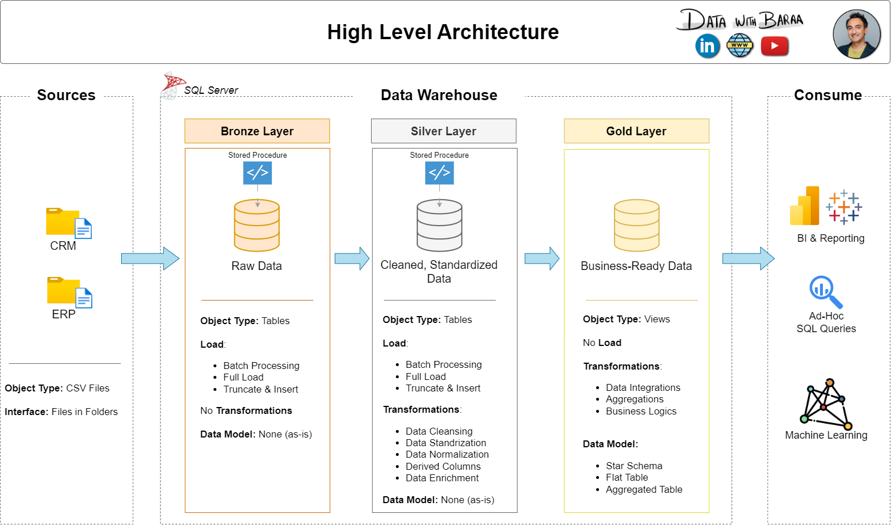

# SQL Data Warehouse and Analytics Project

A SQL Server portfolio project that loads sample CRM and ERP sales data through
Bronze, Silver, and Gold layers. The scripts demonstrate raw ingestion, data
standardization, quality checks, and dimensional views for customer, product,
and sales analysis.

**Stack:** SQL Server, T-SQL, CSV, and Draw.io.

## Architecture



The warehouse uses a medallion-style flow:

1. **Bronze:** source-shaped tables loaded from the CRM and ERP CSV files.
2. **Silver:** standardized and cleansed tables, including normalized
   attributes, corrected dates, and derived sales values.
3. **Gold:** customer and product dimensions plus a sales fact view for
   analytics.

Additional diagrams are available for the [data flow](docs/data_flow.png),
[data model](docs/data_model.png), [ETL process](docs/ETL.png), and
[data integration](docs/data_integration.png).

## Repository layout

```text
datasets/                  Sample CRM and ERP CSV files
docs/                      Architecture, data-flow, and modeling documentation
scripts/
  init_database.sql        Creates the database and schemas
  bronze/                  Bronze DDL and CSV load procedure
  silver/                  Silver DDL and transformation procedure
  gold/                    Analytical dimension and fact views
tests/                     Silver and Gold data-quality queries
```

## Run locally

Requires Microsoft SQL Server and SQL Server Management Studio (SSMS).

1. Open SSMS and connect to a local development SQL Server instance.
2. Review `scripts/init_database.sql`. **It drops and recreates the
   `DataWarehouse` database if it already exists.** Do not run it against a
   database containing data you need.
3. Run `scripts/init_database.sql`, followed by the Bronze and Silver table
   definitions:
   - `scripts/bronze/ddl_bronze.sql`
   - `scripts/silver/ddl_silver.sql`
4. In `scripts/bronze/proc_load_bronze.sql`, update each `BULK INSERT` path to
   the full path where you placed this repository's CSV files. The SQL Server
   service account must be able to read those files.
5. Run `scripts/bronze/proc_load_bronze.sql` and
   `scripts/silver/proc_load_silver.sql` to create the load procedures.
6. Load and transform the sample data:

   ```sql
   EXEC bronze.load_bronze;
   EXEC silver.load_silver;
   ```

7. Create the Gold analytics views by running `scripts/gold/ddl_gold.sql`.
   Execute the checks in `tests/quality_checks_silver.sql` and
   `tests/quality_checks_gold.sql` to inspect data quality and relationships.

The load procedures truncate and reload their target tables. Run this workflow
only in a development database where that behavior is expected.

## Documentation

- [Data catalog](docs/data_catalog.md)
- [Naming conventions](docs/naming_conventions.md)

## Attribution and license

This is a learning project based on the SQL Data Warehouse project by
[Baraa Khatib Salkini (Data With Baraa)](https://www.datawithbaraa.com/).
The original MIT license and copyright notice are retained in [LICENSE](LICENSE).
This repository is presented as a tutorial-based portfolio implementation,
not as original authorship of the upstream project.
